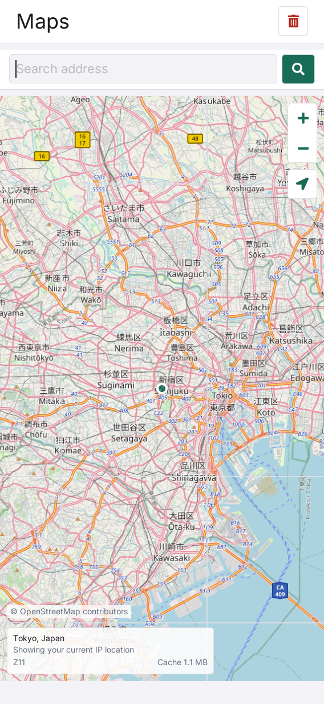
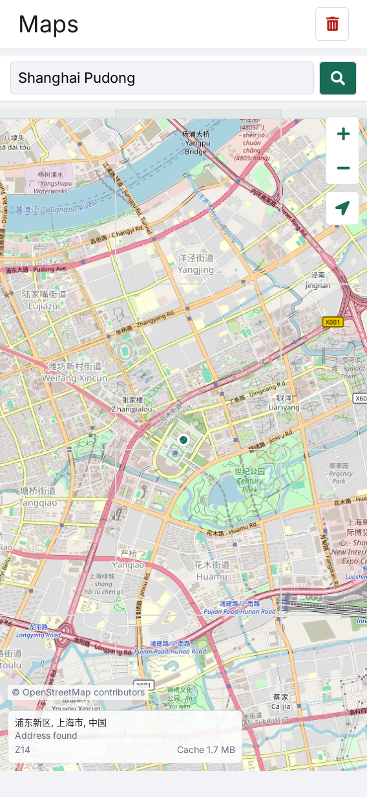

# LILYGO Maps

[English](README.md) | **简体中文**

LILYGO Maps 是面向 LILYGO UI 的在线地图应用，基于 C++17、
[LILYGO UI AppKit](https://github.com/LILYGO-UI/cm0-appkit) 和 LVGL 9.5 构建。
应用优先使用 nRF9151 的有效 GNSS 坐标，未定位时使用公网 IP 提供大致位置，
支持浏览和搜索 OpenStreetMap，并将下载的地图瓦片缓存在设备上以便复用。

项目提供 CM0 ARM64 Linux 设备构建，以及用于开发和测试的 SDL2 桌面模拟器。

## 预览

<p>
  
  
</p>

## 功能

- **地图浏览：** 拖动平移，通过缩放控件浏览 OpenStreetMap。
- **当前位置：** 优先使用 nRF9151 GNSS；搜星中、定位失效或串口不可用时回退到 IP。
  GNSS 恢复后自动切回；点击定位按钮可返回有效 GNSS 或最近一次成功的 IP 位置。
- **地址搜索：** 通过 OpenStreetMap Nominatim 查找地点，支持中英文地址查询。
- **本地瓦片缓存：** 复用已下载的瓦片、查看缓存占用，并在确认后清空缓存。
  已缓存的区域可离线浏览。
- **响应式界面：** 搜索框悬浮于地图上方，支持横竖屏布局、屏幕键盘和地图版权标注。
- **实体键盘：** 聚焦搜索框后可输入地址，使用退格和方向键编辑、Enter 搜索；
  Esc 退出编辑。使用实体键盘时自动收起屏幕键盘。
- **后台处理：** 定位、搜索和瓦片下载在工作线程中运行，保持界面响应。

GNSS 需要兼容的 Nordic SLM 固件、空闲的模组串口和接收条件良好的 GNSS 天线，可离线定位。
IP 定位仅提供大致位置，可能受到 VPN 或代理影响。下载新瓦片、IP 定位和地址搜索需要联网。
详见[服务与缓存配置](docs/02-services-and-cache.md)（英文）。

## 开发环境搭建

项目标识、版本和软件包元数据由 [`lpm.toml`](lpm.toml) 提供。
[`CMakePresets.json`](CMakePresets.json) 定义了 `host-simulator` 和 `cm0-cross` 配置。
所有项目命令均在仓库根目录执行。

### 获取源码

```sh
git clone --recurse-submodules https://github.com/LILYGO-UI/lilygo-ui-maps.git
cd lilygo-ui-maps
```

已有仓库可使用以下命令初始化锁定版本的依赖：

```sh
git submodule update --init --recursive
```

项目直接使用 `third_party/cm0-appkit`，模拟器无需单独安装 AppKit。
默认使用其中附带的 LVGL 9.5.0 源码归档，两种预设均禁用了 LVGL 网络下载。

### 主机依赖

需要 CMake 3.21 或更高版本（包含 CTest 和 CPack）、Python 3.11 或更高版本，
以及支持 C++17 的 C/C++ 编译器。预设使用 Unix Makefiles；
AppKit 还需要 `patch` 来应用附带的 LVGL 补丁。
SDL2 提供主机显示，FreeType 负责字体渲染，json-c 解析服务响应。
网络请求使用 `curl` 可执行文件，因此不需要 libcurl 开发头文件。

#### Debian 12 / Ubuntu 24.04 或更高版本

```sh
sudo apt update
sudo apt install build-essential cmake git pkg-config patch libsdl2-dev \
  libfreetype6-dev libjson-c-dev curl ca-certificates python3 python3-venv python3-pip
```

较旧发行版需要先将 CMake 和 Python 升级到上述最低版本。

#### macOS

按需安装 Xcode Command Line Tools，并通过 [Homebrew](https://brew.sh/) 安装依赖。
完成 Homebrew 的 Shell 配置，确保 `brew` 及其安装的工具位于 `PATH` 中：

```sh
xcode-select --install
brew install git cmake pkg-config patch sdl2 freetype json-c curl python
```

#### LPM

CMake 在配置阶段调用 `lpm metadata --format cmake`。
使用 Python 3.11 或更高版本，在项目虚拟环境中安装 LPM：

```sh
python3 -m venv .venv
. .venv/bin/activate
python -m pip install "git+https://github.com/LILYGO-UI/lpm.git"
lpm --version
```

每次打开新终端后，先执行 `. .venv/bin/activate` 再使用 `lpm`。
CMake 会同时搜索 `.venv/bin` 和 `PATH`。
如需指定其他位置的 LPM，可在配置时传入 `-DLPM_EXECUTABLE=/absolute/path/to/lpm`。

构建前检查主机环境：

```sh
cmake --version
python --version
pkg-config --modversion sdl2 freetype2 json-c
lpm metadata --format cmake
```

### 设备交叉编译器

仅构建桌面模拟器时可跳过此步骤。设备构建需要在开发机上单独安装 AArch64 Linux 交叉编译器。

**Debian / Ubuntu：**

```sh
sudo apt install gcc-aarch64-linux-gnu g++-aarch64-linux-gnu
```

**Apple Silicon macOS：**

```sh
brew install aarch64-unknown-linux-gnu
```

BSP 工具链要求 `PATH` 中存在以下名称的可执行文件：

```sh
aarch64-linux-gnu-gcc --version
aarch64-linux-gnu-g++ --version
```

SDK 对主机和编译器的要求详见 [CM0BspBuilder](https://github.com/LILYGO-UI/CM0BspBuilder)。
BSP 提供目标平台的头文件和库，但不会安装开发机所需的交叉编译器。

## 构建与测试

完成环境搭建后，在仓库根目录使用 LPM。
它会从 `lpm.toml` 读取构建预设和打包输出目录。

### 桌面模拟器

```sh
lpm start --foreground
```

此命令会配置、构建模拟器，然后以前台模式启动。
如需复用已有构建产物，执行 `lpm start --no-build --foreground`。
Debug 构建启用测试，产物位于 `build/host-simulator`。
运行应用需要图形桌面会话。在线功能还需要正常的 DNS、网络连接、
`PATH` 中的 `curl` 以及 CA 证书。离线使用说明见[服务与缓存](docs/02-services-and-cache.md)（英文）。

### 测试

配置、构建主机模拟器并运行全部测试：

```sh
lpm test
```

| 测试 | 覆盖内容 |
| --- | --- |
| `maps-core` | 地图投影、日期变更线环绕、可见瓦片、PNG 校验及缓存操作 |
| `maps-location` | GNSS 优先级及过期、IP 服务回退、无效响应和 HTTP 协议限制 |
| `maps-gnss` | GNSS 协议校验和串口生命周期 |
| `maps-view-model` | 用户命令和异步状态更新 |
| `maps-render-portrait` | `568 x 1232` 下的渲染和主要交互 |
| `maps-render-landscape` | `1232 x 568` 下的渲染和主要交互 |

渲染测试将 `maps-portrait.ppm` 和 `maps-landscape.ppm` 写入 `build/host-simulator`。
修改 UI 后应检查两张图；断言通过并不能验证视觉布局。
UI 验收要求见 [UI 开发规范](docs/01-user-interface.md)。

### CM0 设备构建

设备预设面向 AArch64 架构的 CM0 Raspberry Pi OS，使用 Release 构建，
禁用主机测试，并将安装前缀设为 `/usr`。交叉编译并生成 Debian 软件包：

```sh
lpm pack
```

首次执行 `lpm pack`（或 `cmake --preset cm0-cross`）时，
[工具链包装脚本](cmake/cm0-bsp-toolchain.cmake)会下载 CM0 BSP `0.1.0`，
校验锁定的 SHA-256，并将 sysroot 解压到 `.cache/cm0-bsp/0.1.0/sysroot`。
首次下载需要访问 GitHub，后续配置会复用缓存。
如需修改缓存位置，可在配置时传入 `-DCM0_BSP_CACHE_DIR=/absolute/path/to/cache`。
无需在相邻目录克隆 CM0BspBuilder。

交叉编译需要 SDK sysroot 中的目标平台库和头文件，包括 json-c、FreeType 和 DRM。
主机库不能替代缺失的目标平台依赖。

CPack 将 ARM64 `.deb` 输出到 `dist/`。软件包安装可执行文件、启动器条目及图标、
桌面条目、AppStream 元数据和共享字体许可声明。
目标系统需要提供声明的依赖，包括 `lilygo-ui-appkit-dev >= 0.1.0`、json-c、`curl` 和 CA 证书。
AppKit 在设备上提供共享运行时字体。

<details>
<summary>底层 CMake 命令</summary>

LPM 封装了以下步骤。调试构建配置时也可以直接执行这些命令，但读取项目元数据仍需要 LPM。

主机构建与测试：

```sh
cmake --preset host-simulator
cmake --build --preset host-simulator --parallel
ctest --preset host-simulator
```

设备构建与打包：

```sh
cmake --preset cm0-cross
cmake --build --preset cm0-cross --parallel
cpack --config build/cm0-cross/CPackConfig.cmake -B dist
```

</details>

### 常见问题

| 现象 | 处理方法 |
| --- | --- |
| `lpm is required to read project metadata` | 在 `.venv` 中安装 LPM，将其加入 `PATH`，或设置 `LPM_EXECUTABLE`。 |
| 找不到 `LilyGoUI` 或附带的 LVGL | 执行 `git submodule update --init --recursive`，初始化锁定版本的 AppKit 子模块。 |
| 缺少 SDL2、FreeType 或 json-c | 安装主机开发依赖；交叉编译时检查目标 sysroot。 |
| 找不到 Homebrew 库 | 使用 `cmake --preset host-simulator -DCMAKE_PREFIX_PATH="$(brew --prefix)"` 配置。 |
| BSP 下载失败 | 检查 GitHub Releases 访问情况和可用磁盘空间，然后重新配置。 |
| 地图瓦片或定位无法加载 | 检查 `curl`、网络连接、服务可用性和 `LILYGO_MAPS_DISABLE_NETWORK`，详见[运行时配置](docs/02-services-and-cache.md)（英文）。 |

## 文档

| 指南 | 内容 |
| --- | --- |
| [服务与缓存](docs/02-services-and-cache.md)（英文） | 在线服务、环境变量、缓存路径和离线行为 |
| [架构概览](docs/00-overview.md) | 模块边界、工作线程、数据流和缓存一致性 |
| [UI 开发规范](docs/01-user-interface.md) | 布局、字体、所有权和 UI 验证要求 |

## 致谢

地图数据由 [OpenStreetMap 贡献者](https://www.openstreetmap.org/copyright)提供，
瓦片由 [OpenStreetMap.de](https://www.openstreetmap.de/) 提供，
地址搜索由 [Nominatim](https://nominatim.org/) 提供。
界面使用 LILYGO UI AppKit 和 [LVGL](https://lvgl.io/)。
运行或分发应用时，请遵守相关服务提供方的使用政策。
